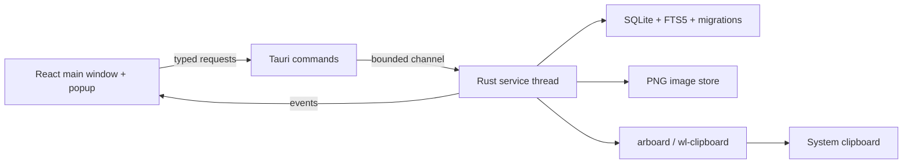

# ClipVault

[Русский](README.md) | **English**

A local clipboard manager built with Rust, Tauri 2, React, TypeScript and SQLite. Search copied text, restore images, keep snippets and organize history without uploading clipboard contents.

**Version 0.2.1 — development preview. Windows x64 EXE and NSIS Setup have been cross-compiled on Linux. Installation and runtime behavior on Windows have not been tested. This is not an acceptance-complete production release.**

## Startup fix in 0.2.1

Fixed the 0.2.0 build defect that made the Windows EXE navigate to localhost:1420 instead of bundled frontend assets. Version 0.2.1 enables `custom-protocol`; release builds without it are now rejected. No development server is needed to install or launch the app.

## Install the supplied Windows build

Preview binaries, checksums and instructions are attached to the repository’s [draft releases](https://github.com/m3wqd/clipvault/releases). Drafts are visible to repository collaborators with the required access.

Use `ClipVault-0.2.1-x64-setup.exe` supplied alongside the source archive. No Rust or Node.js is needed for normal installation. The per-user installer offers a destination directory, Start menu shortcuts, an optional desktop shortcut, and an uninstaller. It includes Microsoft's WebView2 bootstrapper: if WebView2 is missing, internet access is required to install the runtime. The portable `ClipVault-0.2.1-x64.exe` requires an installed WebView2 Runtime.

The application and installer are unsigned. Windows may display a publisher/SmartScreen warning. Checksums accompany the delivered binaries; checksums do not replace a publisher signature. Quit ClipVault from its tray before updating or uninstalling. Normal uninstall preserves history and settings.

## Implemented

- Automatic text capture, URL/code categorization and SQLite persistence.
- BLAKE3 deduplication, timestamps and copy counts.
- FTS5 token-prefix search, type, time, tag, favorite and collection filters; date/frequency sorting and 200-row pagination.
- Pin, favorite, delete, restore to system clipboard and pause/resume.
- Images stored as PNG files, thumbnail IPC, decoded dimension/size limits, and orphan-file reconciliation.
- Native arboard adapter for Windows/X11; wl-paste/wl-copy adapter for Wayland text and PNG.
- Tray menu, single-instance guard, close-to-tray setting, Quick Popup, arrow/Enter/Esc navigation and default Ctrl+Shift+V shortcut on supported desktops.
- Snippet create/edit/delete/search/copy; collections, many-to-many tags and collection membership.
- Persistent retention/size limits, incognito, optional recognition of some sensitive token patterns, dark/light theme and partial English/Russian localization.
- Explicit opt-in autostart. No automatic paste: restore, then press Ctrl+V in the destination.

## Known gaps

Event-driven clipboard notification adapters, Wayland watch-protocol negotiation, full localization, configurable data directory, native platform integration tests, measured CPU/RAM profiling, screenshots/GIFs and signed releases remain unfinished. Identical copies without a different clipboard value between them cannot be reliably counted by the polling adapter. Linux packages and MSI have configuration/scripts but were not built here. The updater is intentionally absent until signing and release URLs are configured. Windows owner/source attribution and application exclusions are implemented but untested on Windows. This repository preserves the development-preview status; binary artifacts are attached to a draft release, not a production release.

Wayland global shortcuts must be bound by the compositor. For Hyprland, after installing the executable, add a binding such as `bind = CTRL SHIFT, V, exec, clipvault --popup`. ClipVault does not bypass compositor restrictions. wl-clipboard access and supported MIME formats vary by session. PNG is the supported Wayland image MIME type; Windows/X11 image decoding is provided by arboard.

## Platforms

Windows 11 x64 and Linux are the target platforms. The following are intended Linux environments, **not a list of verified distributions**:

| Distribution | Build and packaging notes |
| --- | --- |
| Arch Linux | Local-source PKGBUILD is provided; package build and desktop behavior need testing. |
| Ubuntu / Debian | DEB and AppImage configuration is prepared; packages have not been built here. |
| Linux Mint and other Ubuntu-based distributions | Compatibility depends on the base system and available Tauri dependencies; unverified. |
| Fedora | Source builds require the distribution's Tauri development dependencies; unverified. |
| openSUSE and other popular Linux distributions | Source builds and possible AppImage compatibility need validation on the target system. |

Linux requires WebKitGTK 4.1, GTK 3 and the appropriate platform libraries. See the [official Tauri prerequisites](https://v2.tauri.app/start/prerequisites/) for distribution-specific packages. X11 and Wayland use different clipboard adapters; Wayland requires `wl-clipboard` and compositor support. An AppImage does not guarantee compatibility with every distribution.

## Privacy and data

Clipboard history can contain passwords and personal information. Storage is **not encrypted**. Pause or enable incognito before copying secrets. Pattern recognition only catches a small set of private key/token markers; it cannot reliably identify passwords. No clipboard content is logged or sent to a service. App history is local; WebView2 bootstrap installation and developer dependency downloads are separate network operations.

Data is stored in Tauri's application data directory for `io.clipvault.desktop`:

- Windows: `%APPDATA%\io.clipvault.desktop`
- Linux: `${XDG_DATA_HOME:-~/.local/share}/io.clipvault.desktop`

The directory contains `history.db` (plus SQLite WAL/SHM files) and `images/`. Linux directory permissions are 0700; Windows inherits current-user app-data ACLs. Settings provides confirmed history deletion, optionally including pinned records. To remove **all** data, quit the app, back up anything needed, then explicitly remove this application directory. Uninstall alone does not remove it.

## Build from source

Install stable Rust, Node.js 22 LTS/npm and the [official Tauri prerequisites](https://v2.tauri.app/start/prerequisites/). Windows needs Visual Studio C++ Build Tools and WebView2. Linux needs WebKitGTK 4.1, GTK 3 and platform development libraries.

```sh
npm ci
npm run tauri dev
```

Windows EXE/MSI installer build with checks:

```powershell
./packaging/scripts/build-windows.ps1
```

Or double-click `build-windows.cmd`. Build tools are required only for building source, not installing the delivered Setup. The script writes `dist-installers/` and stops if either required installer is absent.

Linux:

```sh
npm run tauri build -- --config src-tauri/tauri.linux.conf.json --bundles appimage,deb
```

For Arch Linux, create a source tarball rooted at `clipvault/`, named `clipvault-0.2.1.tar.gz`; place it next to `packaging/arch/PKGBUILD` and run `makepkg -si` as a non-root user. This is a local source PKGBUILD, not an AUR publication. Its local source checksum is intentionally SKIP; replace it with the independently verified archive hash for distribution.

The delivered Setup was created on Linux using `cargo-xwin` and the checked-in custom NSIS script. The native Windows script instead uses Tauri's NSIS/WiX templates. Both packaging routes require installation testing before public distribution; see [packaging notes](docs/packaging.md).

## Validation

```sh
npm run build
npm test
cargo fmt --manifest-path src-tauri/Cargo.toml --check
cargo clippy --manifest-path src-tauri/Cargo.toml --all-targets --locked -- -D warnings
cargo test --manifest-path src-tauri/Cargo.toml --no-default-features --lib --locked
python3 tests/schema_test.py
```

Actual checks and remaining acceptance work are recorded in [validation](docs/validation.md). Tests use temporary data; application runtime never seeds demonstration history. Browser-only mode cannot access history and reports an IPC connection error.

## Architecture



The worker owns clipboard and database objects. SQL values are bound; FTS terms are quoted. Image names are generated hashes and validated before reads. Restoring contents suppresses capture of the same value. See [architecture](docs/architecture.md).

GitHub Actions separately validates/packages Windows and Linux, with required-artifact checks and SHA-256 files. Workflows are prepared, but no successful CI run is claimed. Updater signing and public release publication remain disabled.

MIT license. See CONTRIBUTING.md.
