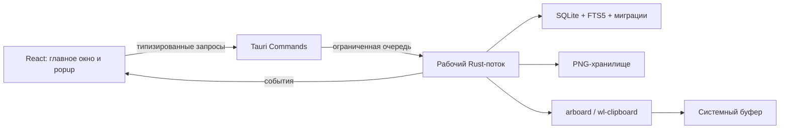

# ClipVault

**Русский** | [English](README.en.md)

Локальный менеджер буфера обмена на Rust, Tauri 2, React, TypeScript и SQLite. ClipVault сохраняет историю текста и изображений, помогает находить ранее скопированное, хранить шаблоны и группировать записи без отправки содержимого на сервер.

**Версия 0.2.0 — тестовая сборка. Windows x64 EXE и NSIS Setup собраны на Linux посредством кросс-компиляции. Установка и работа на Windows ещё не проверены. Критерии готовности production-релиза пока не выполнены.**

## Установка на Windows

EXE, установщик, контрольные суммы и инструкция находятся в [черновике релиза](https://github.com/m3wqd/clipvault/releases). Доступ к черновикам зависит от прав пользователя в репозитории.

Для обычной установки запустите `ClipVault-0.2.0-x64-setup.exe`. Rust и Node.js не требуются. Установщик работает для текущего пользователя, позволяет выбрать папку, создаёт ярлыки в меню «Пуск», предлагает необязательный ярлык на рабочем столе и устанавливает программу удаления. Если Microsoft WebView2 отсутствует, включённый в установщик загрузчик Microsoft установит среду выполнения; для этого нужен интернет.

Отдельный `ClipVault-0.2.0-x64.exe` требует уже установленной среды Microsoft WebView2 Runtime.

Приложение и установщик не подписаны: Windows может показать предупреждение SmartScreen или неизвестного издателя. Контрольные суммы позволяют проверить целостность файлов, но не заменяют подпись. Перед обновлением или удалением завершите приложение через пункт **Quit** в трее. Обычное удаление сохраняет историю и настройки.

## Возможности

- Автоматическое сохранение текста, определение URL и фрагментов кода, хранение истории в SQLite.
- Дедупликация через BLAKE3, время копирования и счётчик повторений.
- Поиск FTS5 по началу слов; фильтры по типу, времени, тегам, избранному и коллекциям; сортировка по дате и частоте; страницы по 200 записей.
- Закрепление, избранное, удаление, восстановление записи в системный буфер и Pause/Resume.
- Изображения в отдельных PNG-файлах, миниатюры, ограничения размера и удаление файлов, на которые больше нет ссылок в базе.
- Адаптер arboard для Windows/X11; `wl-paste` и `wl-copy` для текста и PNG в Wayland.
- Системный трей, защита от запуска нескольких экземпляров, закрытие в трей, Quick Popup, управление стрелками, Enter и Esc. Сочетание по умолчанию — **Ctrl+Shift+V** в поддерживаемых окружениях.
- Создание, редактирование, удаление, поиск и копирование текстовых шаблонов; коллекции и связи many-to-many для тегов и коллекций.
- Сохраняемые лимиты размера и срока хранения, инкогнито, необязательное распознавание некоторых маркеров чувствительных данных, тёмная и светлая темы, частичная русская и английская локализация.
- Автозапуск только по явному выбору пользователя. Автоматической вставки нет: выберите запись, затем нажмите **Ctrl+V** в нужном приложении.

## Что ещё не готово

Остаются событийные адаптеры отслеживания буфера, проверка протоколов `wl-paste --watch`, полный перевод интерфейса, выбор каталога данных, интеграционные тесты на целевых ОС, измерение CPU/RAM, скриншоты и GIF-демонстрация, подпись релизов. Опрос буфера может пропустить быстрые изменения и не позволяет надёжно учитывать повторное копирование одинакового содержимого без промежуточного изменения.

Для MSI и Linux-пакетов подготовлены конфигурации и сценарии, но сами пакеты здесь не собраны. Обновлятор отсутствует до настройки подписей и адресов релизов. Определение владельца буфера и исключения приложений реализованы для Windows, но на Windows ещё не проверены. Файлы доступны как черновик тестового релиза.

В Wayland глобальное сочетание нужно назначать средствами композитора. Например, для Hyprland после установки исполняемого файла можно задать `bind = CTRL SHIFT, V, exec, clipvault --popup`. Приложение не обходит ограничения композитора. Доступность буфера и форматов зависит от сессии. Для изображений в Wayland поддерживается MIME-тип PNG; на Windows/X11 декодирование обеспечивает arboard.

## Платформы

Целевые платформы — Windows 11 x64 и Linux. Ниже перечислены предполагаемые Linux-окружения; **это не список дистрибутивов с подтверждённой совместимостью**.

| Дистрибутив | Сборка и пакеты |
| --- | --- |
| Arch Linux | Есть PKGBUILD для локального архива исходников; сборка пакета и работа в desktop-сессии требуют проверки. |
| Ubuntu / Debian | Подготовлены конфигурации DEB и AppImage; пакеты здесь не собирались. |
| Linux Mint и другие дистрибутивы на базе Ubuntu | Совместимость зависит от базовой системы и доступных зависимостей Tauri; не проверена. |
| Fedora | Для сборки из исходников нужны зависимости Tauri для этого дистрибутива; совместимость не проверена. |
| openSUSE и другие популярные Linux-дистрибутивы | Требуется проверка сборки из исходников и возможной совместимости AppImage на целевой системе. |

Для Linux нужны WebKitGTK 4.1, GTK 3 и соответствующие платформенные библиотеки. Списки пакетов для разных дистрибутивов приведены в [официальных требованиях Tauri](https://v2.tauri.app/start/prerequisites/). Для X11 и Wayland используются разные адаптеры; Wayland требует `wl-clipboard` и поддержки со стороны композитора. Формат AppImage сам по себе не гарантирует работу на любом дистрибутиве.

## Приватность и данные

В историю могут попасть пароли и персональные сведения. Хранилище **не зашифровано**. Перед копированием секретов приостанавливайте отслеживание или включайте инкогнито. Распознавание шаблонов охватывает лишь некоторые маркеры приватных ключей и токенов и не даёт надёжной защиты паролей.

Содержимое буфера не записывается в логи и не отправляется в сервис. История хранится локально. Загрузка WebView2 при установке и загрузка зависимостей для разработки — отдельные сетевые операции.

Данные находятся в каталоге приложения Tauri с идентификатором `io.clipvault.desktop`:

- Windows: `%APPDATA%\io.clipvault.desktop`.
- Linux: `${XDG_DATA_HOME:-~/.local/share}/io.clipvault.desktop`.

Внутри находятся `history.db`, служебные SQLite-файлы WAL/SHM и каталог `images/`. На Linux для каталога устанавливаются права 0700; Windows использует унаследованные права каталога данных текущего пользователя.

В настройках есть подтверждаемая очистка истории, включая закреплённые записи по отдельному выбору. Для удаления **всех** данных завершите приложение, сохраните нужное и явно удалите каталог приложения. Обычное удаление программы этого не делает.

## Сборка из исходников

Установите stable Rust, Node.js 22 LTS/npm и зависимости из [официальной инструкции Tauri](https://v2.tauri.app/start/prerequisites/). Для Windows нужны Visual Studio C++ Build Tools и WebView2. Для Linux — WebKitGTK 4.1, GTK 3 и платформенные библиотеки разработки.

```sh
npm ci
npm run tauri dev
```

Сборка Windows EXE/MSI с проверками:

```powershell
./packaging/scripts/build-windows.ps1
```

Также можно запустить `build-windows.cmd`. Инструменты разработки нужны для сборки исходников, а не для установки готового Setup. Сценарий сохраняет пакеты в `dist-installers/` и завершится ошибкой, если один из обязательных установщиков отсутствует.

Сборка для Linux:

```sh
npm run tauri build -- --config src-tauri/tauri.linux.conf.json --bundles appimage,deb
```

Для Arch Linux подготовьте архив `clipvault-0.2.0.tar.gz` с корневым каталогом `clipvault/`, положите его рядом с `packaging/arch/PKGBUILD` и выполните `makepkg -si` от обычного пользователя. Это локальный PKGBUILD, а не опубликованный пакет AUR. Для локального архива указана контрольная сумма `SKIP`; перед распространением замените её независимо проверенным хешем архива.

Предоставленный Setup собран на Linux через `cargo-xwin` и включённый в репозиторий собственный NSIS-сценарий. Сценарий для нативной сборки на Windows использует шаблоны NSIS/WiX от Tauri. Обе схемы упаковки требуют проверки установки перед распространением; подробности — в [заметках об упаковке](docs/packaging.md).

## Проверки

```sh
npm run build
npm test
cargo fmt --manifest-path src-tauri/Cargo.toml --check
cargo clippy --manifest-path src-tauri/Cargo.toml --all-targets --locked -- -D warnings
cargo test --manifest-path src-tauri/Cargo.toml --no-default-features --lib --locked
python3 tests/schema_test.py
```

Фактически выполненные проверки и оставшиеся сценарии перечислены в [отчёте](docs/validation.md). Тесты используют временные данные; приложение не заполняет историю демонстрационными записями. В браузерном режиме доступ к истории отсутствует и отображается ошибка подключения IPC.

## Архитектура



Рабочий поток владеет объектами буфера и базы. SQL-параметры передаются через привязку, поисковые термы FTS экранируются. Имена изображений генерируются из хешей и проверяются перед чтением. Восстановление записи подавляет её повторный захват. Подробнее — в [описании архитектуры](docs/architecture.md).

GitHub Actions раздельно проверяет и собирает Windows и Linux, проверяет наличие обязательных пакетов и создаёт SHA-256. Workflows подготовлены, но успешный запуск CI не заявляется. Подпись обновлений и публикация публичного релиза пока не настроены.

Лицензия [MIT](LICENSE). Правила участия — в [CONTRIBUTING.md](CONTRIBUTING.md).
